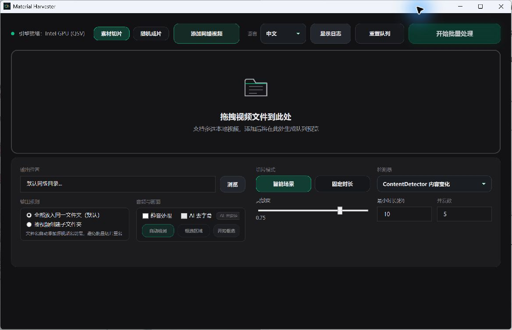
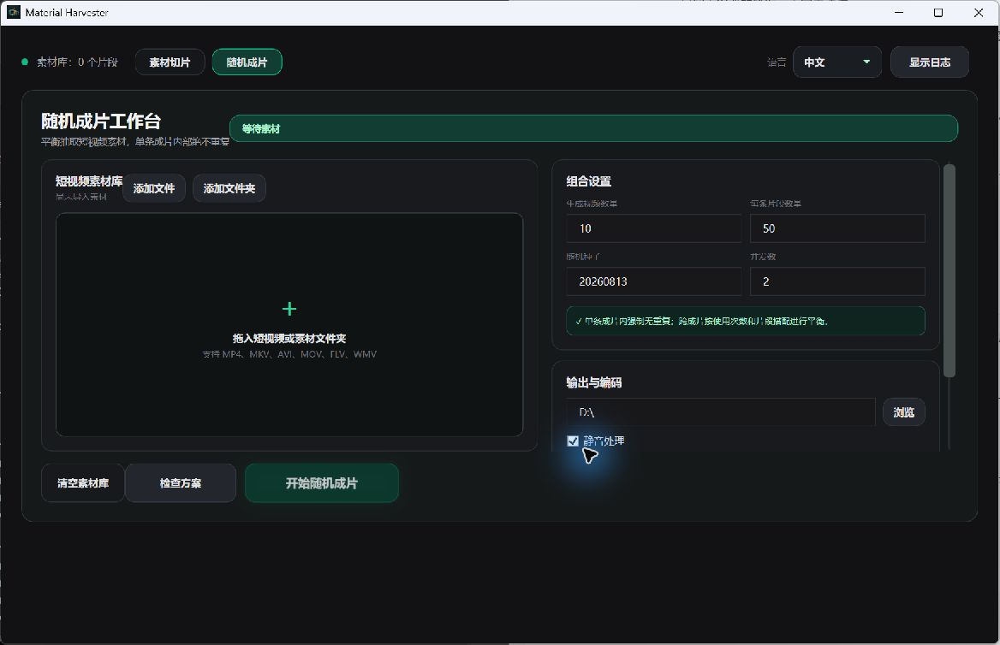

# Material Harvester

把长视频切成素材，再将短片随机组合成新视频。适用于 Windows 10 / 11（64 位）。

**[下载最新版](https://github.com/Lucoshin/MaterialHarvester/releases/tag/v0.1.0)** · [使用方法](#快速使用) · [源码构建](CONTRIBUTING.md) · [反馈问题](https://github.com/Lucoshin/MaterialHarvester/issues)

## 下载

| 文件 | 适合谁 |
| --- | --- |
| [绿色版 ZIP（推荐）](https://github.com/Lucoshin/MaterialHarvester/releases/download/v0.1.0/MaterialHarvester-Green.zip) | Windows 直接解压，运行 `MaterialHarvester.exe`，无需安装 .NET |
| [绿色版 7z](https://github.com/Lucoshin/MaterialHarvester/releases/download/v0.1.0/MaterialHarvester-Green.7z) | 内容相同，压缩包更小，需解压工具 |
| [单文件 EXE](https://github.com/Lucoshin/MaterialHarvester/releases/download/v0.1.0/MaterialHarvester-win-x64.exe) | 已有配套工具的用户；切片和下载需将 FFmpeg、ffprobe、yt-dlp、Deno 放在同目录 |

当前发布的是 **NoAI 版**：绿色包包含 .NET 运行时和视频处理、下载工具，不包含 AI 去字幕引擎与模型。需要平台扫码登录时，电脑还需安装 Microsoft Edge WebView2 Runtime。

可用 [SHA256SUMS.txt](https://github.com/Lucoshin/MaterialHarvester/releases/download/v0.1.0/SHA256SUMS.txt) 校验下载文件。

## 可以做什么

- **批量切片**：按场景变化拆分、相似片段去重，或按固定时长切片。
- **指定位置取片**：仅保留开头、首尾或首中尾片段。
- **随机成片**：组合短视频素材，单条成片内不重复，跨成片平衡素材使用次数。
- **链接导入**：下载后自动加入队列；支持抖音、小红书、B站的内置扫码登录。
- **硬件加速**：优先使用可用的显卡编码器，失败时回退 CPU；支持静音和批量输出。

## 快速使用

1. 下载并解压绿色包，打开 `MaterialHarvester.exe`。
2. 在“素材切片”中拖入视频，选择输出目录和切片方式，点击“开始批量处理”。
3. 需要组合短片时，切换到“随机成片”，导入素材，设置成片数量和每条片段数后开始生成。

查看随机成片界面

English quick start

Material Harvester is a Windows desktop app for batch video slicing and random clip composition. Download the portable ZIP above, extract it, and run `MaterialHarvester.exe`. The app supports Chinese and English UI.

The portable package includes .NET, FFmpeg, ffprobe, yt-dlp and Deno. This release is **NoAI** and excludes subtitle-removal engines and models. Embedded platform login requires Microsoft Edge WebView2 Runtime. The standalone EXE needs the companion video tools in the same folder.

## 开源与许可

源码采用 [MIT 许可证](LICENSE)。第三方工具遵循各自许可证，详见 [第三方说明](THIRD_PARTY_NOTICES.md)。开发环境和构建步骤见 [贡献指南](CONTRIBUTING.md)。
